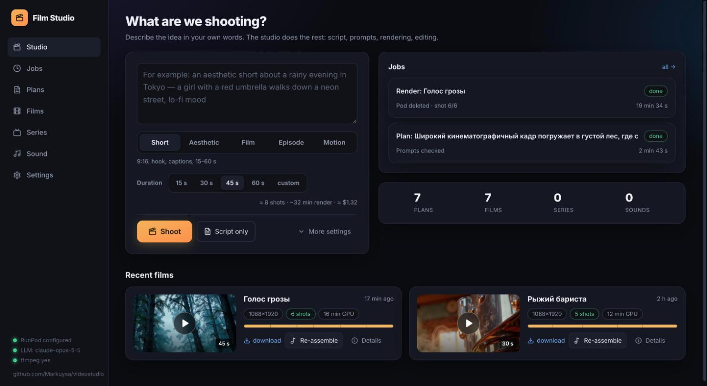
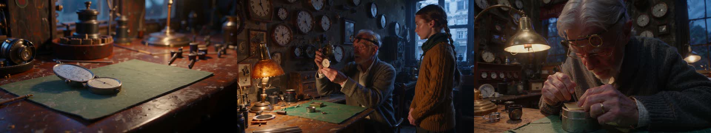
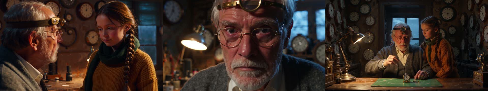
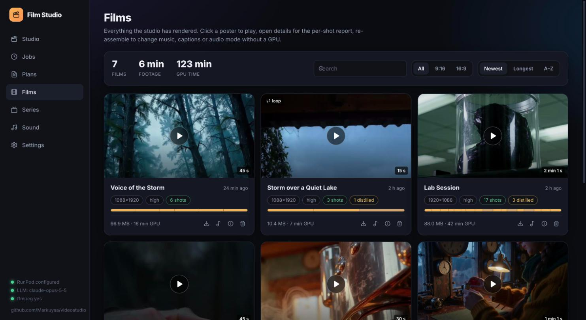
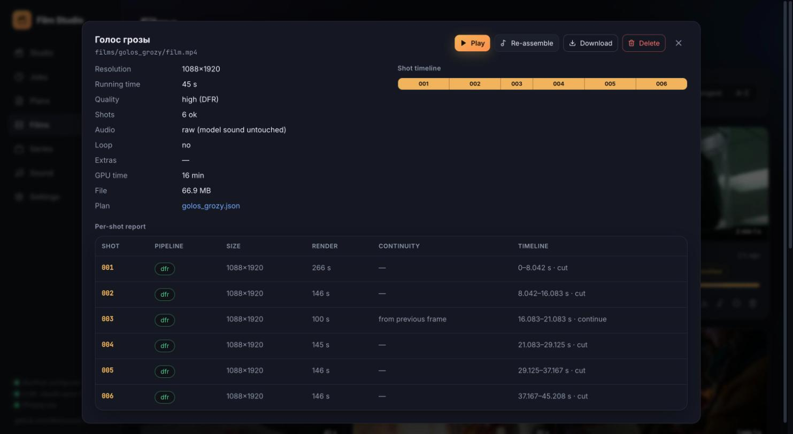
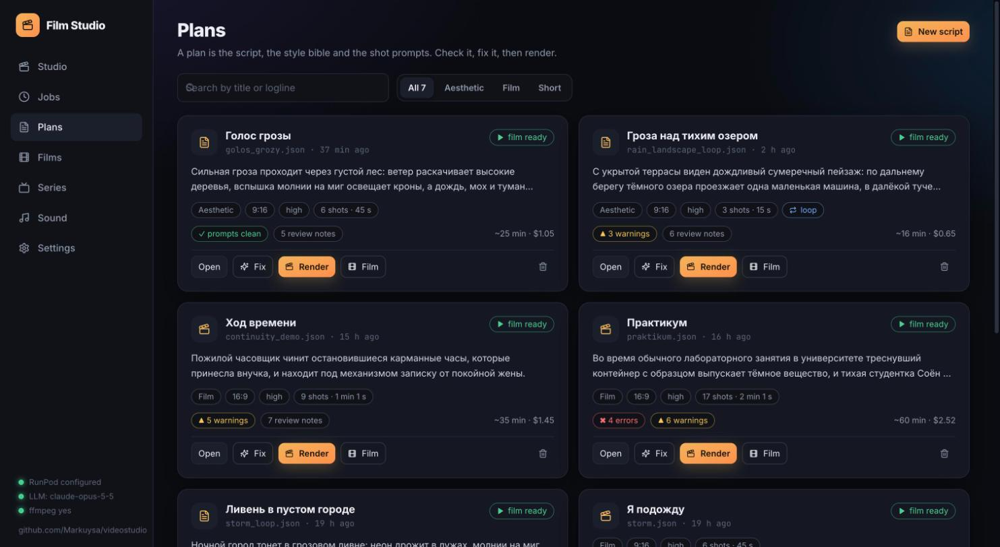
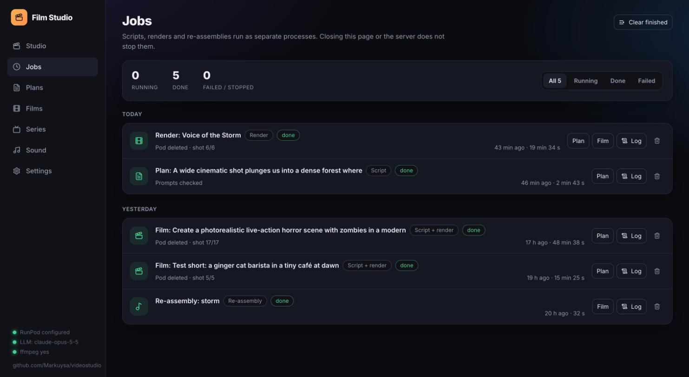
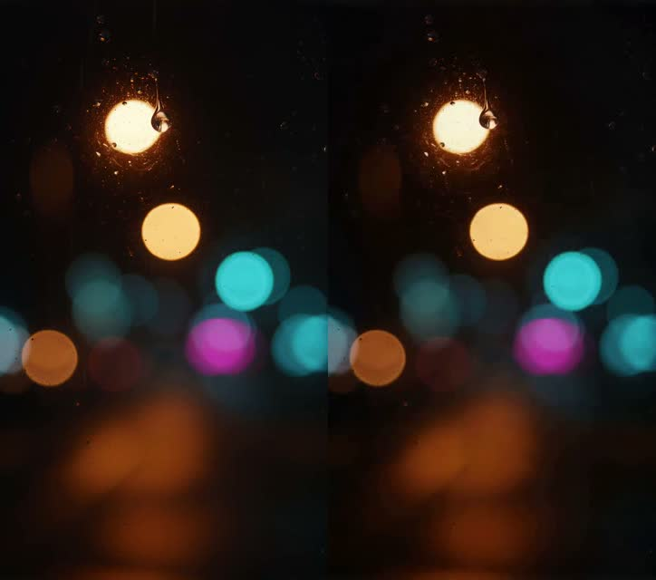
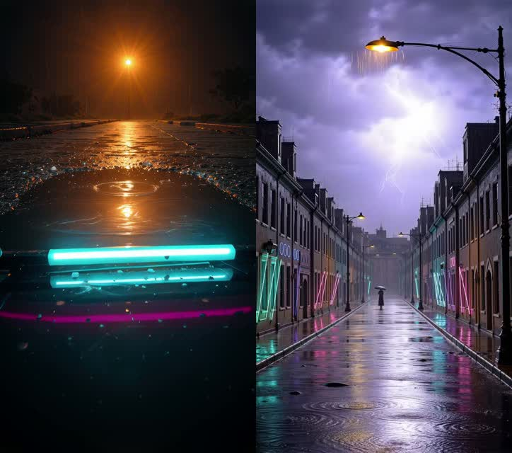

<div align="center">

# 🎬 Film Studio

**An autonomous AI film studio: a sentence in → a finished film out.**

Script and shot list written by Claude · every shot rendered by LTX‑2.5 (video + audio) on a RunPod GPU ·
seamless assembly with ffmpeg · a React control room to run it all.

[](#installation)
[](#web-interface)
[](https://huggingface.co/Lightricks/LTX-2.5)
[](https://www.anthropic.com)
[](#tests)
[](LICENSE)



</div>

```bash
python studio.py make "A quiet drama: an old watchmaker repairs a pocket watch his granddaughter brought \
and finds a note from his late wife inside" --kind film --duration 60
```

That single command writes the screenplay, the style bible and nine shot prompts, starts a GPU pod,
renders every shot in 1080p, stitches them into one film with continuity across cuts, downloads
`films/<slug>/film.mp4` and deletes the pod. About 20 minutes of GPU time.

<div align="center">


<sub>Six frames from <i>The Passage of Time</i>: nine independently generated clips, one workshop, one watchmaker, one granddaughter.</sub>
</div>

---

## What it does

| | |
|---|---|
| 🧠 **Writes the film** | Story, acts, style bible, characters with verbatim visual descriptors, a prompt per shot optimized for LTX‑2.5 (camera → subject → action → light → sound). Director review checks the text against your request, continuity and feasibility. |
| 🔗 **Keeps continuity** | A *world anchor* sentence is injected verbatim into every prompt; each shot carries `direction.start/end`, and the next shot starts from the previous end state. Pronouns without a character descriptor are lint errors. |
| 🎞 **Renders on demand** | Spins up a RunPod GPU, installs LTX‑2.5 once on a network volume, renders DFR 1080p with a fallback chain (DFR → distilled → fast), caches clips, resumes after interruptions, deletes the pod. |
| ✂️ **Assembles seamlessly** | Hard cuts with micro audio fades, `continue` shots conditioned on the previous last frame, dissolves, music with speech ducking, SFX, voice‑over, burned captions with a 9:16 safe zone. Seamless **loops**: the last shot is conditioned on the first frame of the film. |
| 🔊 **Respects the sound** | By default the model's audio is passed through untouched; optional scene leveling with a true‑peak limiter. Prompt rules prevent “hiss”‑style audio. |
| 📺 **Formats** | `short` (9:16, hook, captions), `aesthetic` (mood piece), `film` (drama), `episode` (series with a character bible), `motion` (graphic animation). |
| 🖥 **Control room** | React + TypeScript UI: compose, watch jobs with live logs and per‑shot progress, review and edit plans, play films, inspect per‑shot reports, re‑assemble, manage series bibles and the sound library. |

---

## Web interface

```bash
python studio.py ui          # http://127.0.0.1:8765
```

<div align="center">

<sub>Films: poster‑first library, timeline per film, one‑click player.</sub><br/><br/>

<sub>Per‑shot report: pipeline used, render time, continuity, loop closure, audio mode.</sub><br/><br/>

<sub>Plans: lint status, render time, director review notes, one‑click render.</sub><br/><br/>

<sub>Jobs: live progress, stages, logs, stop and clear.</sub>
</div>

The interface is a Vite + React 19 + TypeScript app in `ui/` (Tailwind v4, lucide icons). The production
build is committed to `studio/web/` and served by the Python server, so **no Node.js is needed to run it**.
To work on the UI: `cd ui && pnpm install && pnpm dev` (proxies `/api` and `/files` to :8765), then
`pnpm build`.

Use **Help develop the idea** below the idea field to draft editable creative direction:
subject, setting, action, camera, light, sound and continuity. The assistant uses the configured
Anthropic/Ollama provider, standing preferences and the selected series bible. Review its assumptions
and questions, edit the fields, then choose **Apply direction**. The next script receives this direction
alongside your original idea; the existing planner creates the final LTX-2.5 shot prompts.
Changing the idea or creative settings requires updating the direction. This step does not start a GPU render.

---

## Installation

```bash
git clone https://github.com/Markuysa/videostudio.git && cd videostudio
python3 -m venv .venv && .venv/bin/pip install anthropic pytest
cp film_config.example.json film_config.json      # runpod_api_key, network_volume_id, anthropic_api_key
brew install ffmpeg                                # only for local re-assembly
.venv/bin/python studio.py doctor
```

You need a RunPod account with a Network Volume (100+ GB) and accepted licenses for
[LTX‑2.5](https://huggingface.co/Lightricks/LTX-2.5) and the
[spatial upscaler IC‑LoRA](https://huggingface.co/Lightricks/LTX-2.5-22b-IC-LoRA-Pixel-Spatial-Upscaler)
(`hf_token` in the config for the first install). Models (~70 GB) are downloaded to the volume once; every
later render starts within a minute. Without an Anthropic key the planner falls back to a local Ollama
model (works, but scripts are noticeably weaker).

---

## Commands

| Command | What it does |
|---|---|
| `studio.py make "request" [--kind] [--duration] [--format] [--quality] [--loop] [--audio raw\|leveled]` | script + render + download |
| `studio.py plan "request" ...` | script only → `plans/<slug>.json` |
| `studio.py render plans/x.json [--keep-pod]` | render an existing plan |
| `studio.py review plans/x.json [--fix]` | lint; with `--fix` run the director review and repair prompts |
| `studio.py assemble films/<slug> [--music track] [--captions] [--audio raw\|leveled]` | re‑assemble from downloaded clips, no GPU |
| `studio.py series new "description" --name tokyo --episodes 6` | create a series bible |
| `studio.py plan "episode request" --series tokyo` | an episode driven by the bible |
| `studio.py prefs "photoreal, never 3D-animated"` | standing preferences for every future plan |
| `studio.py estimate plans/x.json` · `fetch <slug>` · `cleanup` · `assets` · `ui` | estimate · fetch from volume · delete pods · re‑index sounds · web UI |

---

## How it works

```
 request ──▶ Planner (Claude) ──▶ plan.json ──▶ RunPod GPU: LTX-2.5 per shot ──▶ ffmpeg assembly ──▶ film.mp4
             outline · shots       prompts,       DFR 1080p, fallbacks,            cuts · continue · dissolve
             director review       direction,     last-frame continuity,           music · sfx · captions
             lint · repair         anchor         loop closing, clip cache         raw or leveled audio
```

**Plan** — plain JSON you can edit by hand: title, style bible with `anchor`, characters with `descriptor`,
shots with `seconds`, `transition` (`cut` / `continue` / `dissolve`), `prompt`, `direction`, optional
`caption`, `narration`, `sfx`; plus `music`, `captions`, `loop`, `audio`.

**Prompting** — rules in `studio/knowledge.py`: one English paragraph of 70–180 words, present tense,
framing → persistent character descriptor → action → camera move → light → sound with quoted dialogue;
no on‑screen text, no negations, no “hiss”. `studio/lint.py` checks every prompt deterministically.

**Rendering** — `remote/film.py` on the pod: DFR with an input frame crashes at 193+ frames in the keyframe
decoder, so conditioned shots are kept at 5 s and fall back to distilled 1080p with the same frame;
the final shot of a loop always renders distilled. Clips are cached by prompt content.

**Audio** — `audio: raw` (default) passes the model's sound through with only format conversion and
60 ms fades at cuts; `audio: leveled` matches scenes (+18/−12 dB, −3 dBTP limiter) and applies one
measured gain toward −14 LUFS with a true‑peak limiter — never a dynamic normalizer.

<div align="center">


<br/><sub>A seamless loop: first and last frame of <i>Downpour in an Empty City</i> (PSNR 37 dB), and two shots from the middle.</sub>
</div>

---

## Tests

```bash
.venv/bin/python -m pytest -q tests
```

Plan schema and frame grid, prompt linter, continuity (anchor injection, state ledger), ffmpeg filter
graph and a real assembly of synthetic clips, planner with a fake LLM, full pod‑side run with a simulated
LTX (fallbacks, cache, loop closing), CLI and web API.

## Layout

```
studio.py            CLI                     ui/                React + TypeScript source
studio/              package (shipped to the pod)
  planner.py         Claude planner: outline → shots → director review → lint → repair
  knowledge.py       LTX-2.5 prompting rules, format presets
  lint.py            deterministic prompt linter
  schema.py          plan model, validation, 8k+1 frame grid
  assemble.py        ffmpeg assembly (cuts, dissolves, loop, music, sfx, captions, audio modes)
  render_remote.py   RunPod orchestration
  ui.py, jobs.py     HTTP API + background jobs     studio/web/   built UI (committed)
remote/              pod side: ltx_studio.sh, film.py, film_night.sh
plans/ films/ series/ assets/ docs/
```

<div align="center"><sub>Built with LTX‑2.5 by Lightricks, Claude by Anthropic, ffmpeg, RunPod.</sub></div>
